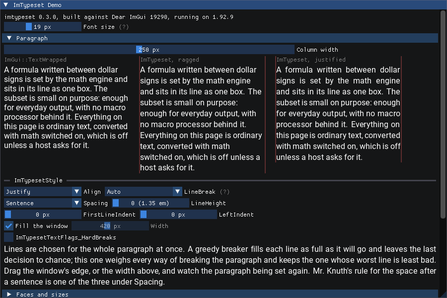

# imtypeset

Dear ImGui draws text; this typesets it.

A C++17 extension for Dear ImGui, in the shape `implot` has. It lays text out
the way TeX does (boxes, glue and penalties; lines chosen for the whole
paragraph at once; formulas built from a math list) and draws the result
through ImGui's own font atlas, every glyph on a whole pixel. Justified
paragraphs, mixed faces and sizes, inline and display formulas, selection with
copy, and a document of thousands of blocks (paragraphs, headings, lists,
code, tables) that lays out only what is on screen and can be shown in
columns.



*`ImTypeset::ShowDemoWindow()`, the Paragraph section, drawn with no display by
`example_demo_headless`. The seventeen `demo-*.png` pages in the repository are
what that program renders from the tree the presets below were run on
(2026-10-11), pixel for pixel (the command is under "Running"), and each was
looked at. Other pages: [math](docs/images/demo-math.png),
[the specimen](docs/images/demo-specimen.png),
[the formula gallery](docs/images/demo-formulas.png),
[selection](docs/images/demo-selection.png),
[a long document](docs/images/demo-document.png),
[a table cut across two columns](docs/images/demo-document-columns.png).
Other pictures, each made earlier, by the task that built the thing shown, and
not re-made since:
[a specimen paragraph](docs/images/paragraph.png),
[the demo in an X window through OpenGL](docs/images/demo-sdl2-opengl3-xvfb.png),
[the Python host](docs/images/py-host.png),
[a `Document` beside pptmstr's own pane, on pptmstr's wheel](docs/images/py-bundle-pptmstr-document.png).*

**Status, 2026-10-11.** Version 0.2.0, unreleased, **no licence chosen**. Built
and tested with one compiler on one platform: GCC 12.2 on Linux x86-64. Clang
and MSVC have never compiled it. It needs Dear ImGui 1.92.0 or later and is
tested against 1.92.9. What works, what does not and what is rough is said
below with the numbers that were measured; `docs/spec-status.md` holds the
design note it started from against what was found.

Contents: [Running the demos and examples](#running-the-demos-and-examples) ·
[Using it from C++](#using-it-from-c) · [Python](#python-advtext-and-pptmstr) ·
[Supported and not](#what-is-and-is-not-supported) ·
[Known rough edges](#known-rough-edges) · [Performance](#performance) ·
[Robustness and fonts](#robustness-and-fonts) ·
[The reference](#the-python-reference-and-the-goldens) ·
[Licence](#licence) · [Before publication](#missing-before-publication)

---

## Running the demos and examples

Every command below was run from a build directory that did not exist before
it and what it printed is what is reported: sections 1, 2, 3, 6 and 7 again on
2026-10-11, on the tree with tables, columns and the galleries in it; sections
4 and 5 on 2026-10-10 and not since (the Python host of 5 is built and tested
by the `python-host` preset of 3, which was). They were run inside a sandbox that has no display: **nothing here
was seen in a window on a real screen, with a GPU, or under a real mouse.**
Where a program opens a window it was run on Xvfb (a real X server in memory,
OpenGL by Mesa's llvmpipe) through `tools/shot.sh`, or with SDL's `dummy` or
`offscreen` video driver, and photographed; each entry says which.

**What you need.** CMake 3.21 or later, Ninja, a C++17 compiler (only GCC 12.2
has been tried). No network: Dear ImGui 1.92.9 is taken from `.deps/imgui` when
that directory is there (it is untracked; a fresh clone fetches the tag from
GitHub once, or takes `-DIMTYPESET_IMGUI_DIR=/path/to/imgui`). FreeType is used
when CMake finds it and stb_truetype otherwise. SDL2 is needed only by the
windowed demo and the self-hosted Python host, and it is not in the repository.
It is looked for in this order, and the configure step prints which answered
(`cmake/sdl2.cmake`):

1. `-DIMTYPESET_SDL2_DIR=<dir>`, when given: an SDL2 install prefix, or the
   CMake build tree that built one.
2. An installed SDL2, by the way CMake finds any package and with nothing to
   scan for or name: its CMake package (`find_package(SDL2 CONFIG)`: the target
   `SDL2::SDL2` or `SDL2::SDL2-static`, or the `SDL2_INCLUDE_DIRS` and
   `SDL2_LIBRARIES` variables that older packages set in place of a target),
   and then pkg-config's `sdl2`. That is what a distribution's development
   package provides: `libsdl2-dev` on Debian and Ubuntu, `SDL2-devel` on Fedora
   and RHEL.
3. `.deps/sdl2`, filled once by `tools/vendor_sdl2.sh <dir>` from any SDL2 2.x
   that is already built. `.deps/` is untracked, so a fresh clone on a machine
   with no SDL2 package needs this or 1.

With none of them the configure stops and says the same. **The second route has
not been run against a distribution's package: this machine has none
installed.** What was run is each branch of it against a stand-in that points
at `.deps/sdl2`: a hand-written `sdl2.pc` on `PKG_CONFIG_PATH`, and three
hand-written `SDL2Config.cmake` files, one for each form (the target
`SDL2::SDL2`, the target `SDL2::SDL2-static`, the two variables and no target).
Each configured, built without a warning and
ran the demo for three frames; the Python host was built and its test passed
through the `sdl2.pc` one. Whether a real package's files behave as the
stand-ins do is not known. The copy the commands below were run with is SDL
2.32.10 as a static debug build for x86-64 Linux
(`.deps/sdl2/PROVENANCE.txt`), and is good for nothing else.
The Python parts need Python 3.11 and, for the bundle route, the application's
own virtual environment and local clones of `imgui_bundle` and `imgui`.

Run all of it from the repository root.

### 1. The demo window (SDL2)

```sh
cmake -S examples/demo_sdl2 -B build/demo -G Ninja
cmake --build build/demo
build/demo/demo_sdl2
```

A 1280 x 800 window holding **ImTypeset Demo** (eleven collapsing sections:
Paragraph, Faces and sizes, Specimen, Math, Formula gallery, Selection,
Inspector, Stress, Fonts, Known limits, Document; the last has a table at its
end, a slider for one to four columns and a switch to balance them) and a small **Host** window that names the video driver, the
renderer and the frame rate. `--backend opengl3` uses ImGui's OpenGL 3 backend
in place of SDL_Renderer; `--fonts DIR` takes the fonts from elsewhere than
`tests/data/fonts`. The first line it prints is `demo_sdl2: video_driver=x11`
(or `wayland`); `offscreen` means SDL found no display and there is no window
although the program runs.

*Ran:* the build (36 steps, no warning). In the sandbox the
program printed `video_driver=offscreen`, as it must there (run with
`--frames 3`, which ends it after three frames; without that it runs until its
window is closed, which was not tried). Run unattended instead:

```sh
# no display at all: 10 frames, the frame read back to a file
SDL_VIDEODRIVER=dummy build/demo/demo_sdl2 --size 1280x1000 --dpi-scale 1 \
    --open "Paragraph,Faces and sizes" --fill --frames 10 --screenshot out.bmp
# a real X window on Xvfb, photographed from the X server
tools/shot.sh -- examples/demo_sdl2/grab.sh build/demo/demo_sdl2 "$PWD/out" \
    --backend opengl3 --size 1280x800 --dpi-scale 1 --open "Paragraph,Math"
```

Both exit 0; so does `SDL_VIDEODRIVER=offscreen`. The Xvfb run reported
`video_driver=x11`, llvmpipe, and the X grab differing from the program's own
read-back in 46 pixels of 1,024,000 on one run, 79 on a later one and 301 on
2026-10-11; the grab was looked at the first two times and not the third, and
why the count moves was not looked into.

### 2. The compiled examples

They are built by every preset and run by `ctest` with no arguments.

```sh
cmake --preset release && cmake --build --preset release
build/release/examples/example_minimal
build/release/examples/example_specimen                # prints line breaks, writes nothing
build/release/examples/example_specimen some/dir       # also writes seven PNGs there
build/release/examples/example_demo_headless           # runs every demo section, writes nothing
build/release/examples/example_demo_headless some/dir  # also writes some/dir/demo-<section>.png
```

| program | what it shows | ran |
|---|---|---|
| `example_minimal` (`examples/minimal.cpp`, 85 lines) | the smallest host: contexts, two fonts, one justified paragraph with a formula in an ImGui window, three headless frames | `minimal: 3 frames, 1 layout(s), 878 vertices in the last frame`, exit 0 |
| `example_specimen` | the same text set several ways (widths, faces, inline and display math, a refused formula, a selection), rendered by the tests' software renderer | exit 0; with a directory, `faces`, `math-display`, `math-inline`, `math-refused`, `paragraph`, `selection`, `widths` `.png` |
| `example_demo_headless` | the demo window driven by scripted mouse and keyboard through `ImGuiIO`'s event queue; fails if a frame in which nothing happens lays anything out | `demo_headless: 17 pages, ok`, exit 0; with a directory, seventeen `demo-*.png` (all seventeen were looked at) |

The seventeen pages: one for each section but Math, which has three (the source
replaced by a formula that is refused; the stream stepped; the table of the
subset), Document twice (as it opens, and with ten blocks in two columns,
wheeled to the table at its end), and three sections shown alone by
`ShowDemoSection()` in a window of the host's. The PNG writer does not
compress: the pages are 1.4 to 8.9 MB each as written (the copies in
`docs/images` were recompressed without loss). The directory must exist:
neither program creates it (ran for `example_demo_headless`: exit 1). The
first two rows of the table are from 2026-10-10 and were not run by hand
again; `ctest` runs both in every preset.

### 3. The test suite

```sh
cmake --preset release && cmake --build --preset release && ctest --preset release
```

*Ran,* from an empty directory: built in 1 min 27 s at four jobs with no
warning, **50 of 50 tests passed** in 64 s. `ctest` lists the three examples
and the drop-in-files compile test among the 50.

Other presets, same three commands with the name changed:

| preset | what | from an empty directory, here |
|---|---|---|
| `release` | `-O3`; the only one to take a timing from | 50 of 50 |
| `debug` | unoptimised, ImGui's assertions live; also builds three small consumer projects | 51 of 51 |
| `asan` | ASan + UBSan | 50 of 50 (tests 3 min 32 s) |
| `stb` | stb_truetype in place of FreeType | 50 of 50 |
| `wchar16` | Dear ImGui's default 16-bit `ImWchar` | 50 of 50 |
| `amalgamation`, `fp-host` | the library built from the generated drop-in files; the second at `-O3 -march=native` without `-ffp-contract=off` | 50 of 50 each |
| `exceptions` | ASan + UBSan, exceptions on, `IM_ASSERT` throws: where `test_exception_safety` does its work | 50 of 50 (tests 3 min 51 s); four `-Wterminate` warnings, all in Dear ImGui's own destructors |
| `bundle-config` | exceptions on, Dear ImGui Bundle's own configuration header (needs `../imgui_bundle`); `test_exception_safety` reports itself skipped here | 50 of 50; the same four warnings |
| `imgui-next` | Dear ImGui 1.93 WIP from `../imgui` (19298, commit `2859f6723`) | 50 of 50 |
| `python-host` | debug plus the Python host and its two tests (needs an SDL2; here from `.deps/sdl2`) | 52 of 52 |

All eleven were run on 2026-10-11 one after another in a single pass, each
from a directory that did not exist, at four jobs, with no warning from this
tree's sources in any, and after the last change to anything they compile or
read: the 492 files of the tree hashed the same before the pass and after it,
and the only edits since are to documents and to the pictures under
`docs/images`. It was the second such pass of the day: the first, also green,
came before one page was added to `example_demo_headless`. The build at `-O2`
(`-DCMAKE_BUILD_TYPE=RelWithDebInfo`, no preset) that gave 41 of 41 on
2026-10-10 was not run on this tree.
The machine these ran on has no swap, and one hostile-input test run against
unfixed code once took all its memory: the sanitised presets set
`ASAN_OPTIONS=hard_rss_limit_mb=3000` for that reason.

One test binary: `build/release/tests/test_draw` (`--list`, `--filter=TEXT`,
`-v`). The corpus tests read the fonts installed on the machine that dumped
their goldens and skip whatever is absent elsewhere.

### 4. The benchmarks

```sh
build/release/bench/bench_draw      # a frame's cost once layout is done    (13 s here)
build/release/bench/bench_font      # getting fonts ready                   (1.3 s)
build/release/bench/bench_reflow    # layout, resize, streaming, growth     (64 s)
```

Built by every preset, run by none. Take numbers from `release` only: each
prints its compiler, flags and the load average with its tables. *Ran:* all
three exit 0. Run each more than once, or after the machine has been busy for
ten seconds: the first rows of a run started cold read up to 1.7 times high
here ([Performance](#performance)).

### 5. The Python host that brings its own window

One shared library holding Dear ImGui, SDL2 and imtypeset, driven from Python
through `ctypes` (`python/imtypeset`). It is the test rig of the Python
binding, not the way into an application; for that see 6.

```sh
cmake -S python -B build/py-host -G Ninja -DCMAKE_BUILD_TYPE=Release
cmake --build build/py-host
ctest --test-dir build/py-host --output-on-failure               # the binding's tests
IMTYPESET_LIBRARY=build/py-host/libimtypeset_pyhost.so \
    python3 -P -B examples/python/minimal_host.py                # the window
```

The window shows `ImGui::TextWrapped` beside a justified paragraph with
formulas, a width slider, drag-selection with Ctrl+C, and a small `Document`.
*Ran:* built in 25 s; `python_binding` passed (9 s); the window command itself
only with `--frames`, that is, unattended:

```sh
IMTYPESET_LIBRARY=build/py-host/libimtypeset_pyhost.so SDL_VIDEODRIVER=dummy \
    python3 -P -B examples/python/minimal_host.py --frames 30 --screenshot out.png
```

printed `frames: 30 selection: (74, 284) layouts: 2` and exited 0, with Python
3.11.2 from the system and from a virtual environment, and again in an X window
on Xvfb (`sh tools/shot.sh -- python3 -P -B examples/python/minimal_host.py
--frames 30 --screenshot "$PWD/out.png"`, with `IMTYPESET_LIBRARY` an absolute
path); that picture was looked at. `examples/python/bench_host.py` times a
frame from Python (not run for this document).

### 6. Inside a Dear ImGui Bundle application, on its installed wheel

The route for an application that already runs on the `imgui_bundle` wheel from
PyPI. One library **per virtual environment**: it is linked against that
interpreter's wheel and refuses any other.

```sh
# arguments: a clone of imgui_bundle, and the interpreter whose wheel it is for
IMTYPESET_BUNDLE_OUT=build/bundle-advtext \
    python/host/build_bundle_library.sh ../imgui_bundle ../imgui-adv-text/.venv/bin/python
IMTYPESET_LIBRARY=$PWD/build/bundle-advtext/libimtypeset_bundle.so \
    ../imgui-adv-text/.venv/bin/python -P -B examples/python/bundle_host.py
```

The script prints the wheel it found, builds (four compiler lines and a link
line), runs the import gate and prints the line to use. The example is one
window drawn by the application's own Dear ImGui through the bundle's `imgui`
binding, with imtypeset drawing into it: `imgui.text_wrapped` beside the same
prose as a justified, selectable paragraph with inline formulas, a slider for
the column width, a display formula, and the selection and clipboard read back
after Ctrl+C. It has no `Document` in it; the self-hosted example of 5 does. It
exits 77 with a sentence when `IMTYPESET_LIBRARY` names no such
library. Here it was run with `--frames 30` on Xvfb, as below, and not left
open.

*Ran,* for two environments holding different wheels:

| environment | wheel | build | `bundle_host.py --frames 30` on Xvfb |
|---|---|---|---|
| `../imgui-adv-text/.venv` | imgui_bundle 1.92.900, Dear ImGui 1.92.9 | 35 s, gate accepted, 24 probes | `selection: (74, 284) layouts: 2`, exit 0 |
| `../pptmstr/.venv` | imgui_bundle 1.92.801, Dear ImGui 1.92.8 | 34 s, gate accepted, 24 probes | the same, exit 0 |

The library's own demo runs there too, as a window or as pages of the
application's (`imtypeset.demo`):

```sh
IMTYPESET_LIBRARY=$PWD/build/bundle-advtext/libimtypeset_bundle.so \
    ../imgui-adv-text/.venv/bin/python -P -B examples/python/bundle_demo.py --show pages --page Specimen
```

*Ran* on Xvfb with `--frames 40 --grab FILE` in both environments, eight ways
each (the window; the window with the Formula gallery and with the Document
open; the pages Specimen, Formula gallery, Math and Document): sixteen runs,
all exit 0 with `last error: 0`. Seven pictures were looked at; the two
environments' pictures differ in 0 to 162 pixels. None shows the table or more
than one column: the script has no way to move the demo's sliders.

The library built for one environment, imported in the other, is refused with
both paths named (ran). What "gate accepted" does and does not mean is under
[Python](#python-advtext-and-pptmstr): both libraries were compiled against
stand-in headers.

### 7. pptmstr with imtypeset in its RICH pane

A patch of three files, `python/spike_bundle/pptmstr_overlay/pptmstr.patch`;
`docs/advtext-rework-plan.md`, "Start here", is the full account.

```sh
IMTYPESET_BUNDLE_OUT=build/pptmstr-bundle \
    python/host/build_bundle_library.sh ../imgui_bundle ../pptmstr/.venv/bin/python
cd ../pptmstr && git apply ../imtypeset/python/spike_bundle/pptmstr_overlay/pptmstr.patch
IMTYPESET_LIBRARY=$HOME/Source/imtypeset/build/pptmstr-bundle/libimtypeset_bundle.so \
PYTHONPATH=$HOME/Source/imtypeset/python  make run     # CONTEXT -> "rich"
```

Without `IMTYPESET_LIBRARY` nothing is imported and pptmstr is what it is
today. **The patch itself was not applied here**: this work may not write into
`../pptmstr`. What ran instead: `git -C ../pptmstr apply --check` on the patch
passes at pptmstr commit `4974657` (750 lines added and 19 removed by `git
apply --numstat`); and the real application, `pptmstr.app.main --fake`, was run
on Xvfb with the patch's three modules imported from the overlay directory in
place of pptmstr's (the command is in the plan). It reported `imtypeset: in
use`, wheel 1.92.801, 3.02 library calls per `rich_pane.draw`, and its picture
was looked at. All of that was run again on 2026-10-11 against a library built
from this tree and gave the same: the patch did not need changing for the
structs that have grown since. `make run` with the patch applied has not been
run by anyone.

---

## Using it from C++

This is `examples/minimal.cpp`, which is compiled and run with the tests, with
its error handling and its comments shortened:

```cpp
#include "imgui.h"
#include "imtypeset.h"

// once, after ImGui::CreateContext() and before the first frame
IMTYPESET_CHECKVERSION();                 // IMGUI_CHECKVERSION() for this library
ImTypeset::CreateContext();
ImTypeset::AddFontFromFileTTF(ImTypesetFace_Regular, "Roboto-Regular.ttf");
ImTypeset::AddFontFromFileTTF(ImTypesetFace_Math, "latinmodern-math.otf");

// every frame, between ImGui::NewFrame() and ImGui::Render()
ImGui::Begin("Typeset");
ImTypeset::TextUnformatted(
    "Lines are chosen for the whole paragraph at once, as TeX chooses them. A formula "
    "such as $e^{i\\pi} + 1 = 0$ is a box on the baseline among the words.",
    nullptr, ImTypesetTextFlags_Math);
ImGui::End();

// at exit
ImTypeset::DestroyContext();
```

One call per paragraph per frame; the layout is kept between frames, found
again by the text itself, and redone when the text, the width or the style
changes. Each call that can fail returns a status, and
`ImTypeset::GetLastError()` has the reason. The first font added is also
ImGui's default font. The renderer backend must announce
`ImGuiBackendFlags_RendererHasTextures`, as every stock backend of ImGui 1.92
does.

The whole public surface is `include/imtypeset.h` (88 functions:
context, fonts, widgets, paragraphs you keep, hit testing and selection,
documents with their tables and columns, the demo window and its sections). `include/imtypeset_c.h` is the same as a C99 ABI
for bindings. `src/imtypeset_demo.cpp` is the place to look up how each thing
is called, as `imgui_demo.cpp` is for ImGui.

### Three ways to add it to a C++ program

`docs/distribution.md` has each in full, with the test that proves it.

1. **Drop-in files**, as Dear ImGui itself is consumed.
   `python3 -I -B tools/amalgamate.py` writes `dist/imtypeset.h`,
   `dist/imtypeset.cpp` (one translation unit of about 29,000 lines),
   optionally `imtypeset_demo.cpp` and `imtypeset_c.h/.cpp`. Add them next to
   ImGui's files: `c++ -std=c++17 -c imtypeset.cpp -I<directory holding imgui.h>`.
   No define is needed; it follows the host's ImGui configuration. Do not
   compile it with `-ffast-math`: it refuses.
2. **`add_subdirectory`**, linked as `imtypeset::imtypeset`. It builds against
   the host's ImGui target (`imgui::imgui`, then `imgui`, or the one named by
   `IMTYPESET_IMGUI_TARGET`) and fails at configure rather than build a second
   ImGui inside a program that has one.
3. **An installed package**, `find_package(imtypeset CONFIG)`, only against an
   installed ImGui; ImGui is never installed from here.

Routes 2 and 3 are the ctest test `consumer_projects` (preset `debug`), and
route 1 is the test `amalgamation` in every preset. A `vcpkg.json` and a port
outline exist and **have never been run**.

**Dear ImGui versions.** The floor is 1.92.0 (19200): `#error` in the header
and a configure error below it, decided by building (1.91.9 does not compile;
1.92.0 and 1.92.8 pass the whole suite in debug). The tested version is 1.92.9,
which the draw goldens were dumped against. 1.93.0 WIP (19298) from a local
checkout passes the suite in debug and was not run in any other configuration.
The library includes `imgui.h` only, never `imgui_internal.h`. (All from
`docs/distribution.md` section 6; not re-run for this file.)

---

## Python: advtext and pptmstr

The need this was built for is two Python applications, `advtext` and
`pptmstr`, each running on a stock `imgui_bundle` wheel from PyPI. imtypeset
reaches them as a **sidecar library inside the unmodified wheel**
(`docs/distribution.md` section 1): `libimtypeset_bundle.so` holds no Dear
ImGui of its own, its ImGui symbols resolve against the wheel's extension
module, and it draws into the application's own context, font atlas and
windows. Nothing is installed into the environment. `python/imtypeset` is a
pure-Python `ctypes` package over the C ABI. Dear ImGui Bundle adopting the
library upstream is backlog and nothing here waits for it.

**How far it goes, exactly.**

- It runs in both wheels on this machine: imgui_bundle 1.92.801 (pptmstr's
  environment) and 1.92.900 (advtext's). Running commands: 6 and 7 above.
- **Stand-in headers and the probe gate.** A wheel ships no headers, and its
  ImGui is a fork. Both libraries are compiled against upstream Dear ImGui's
  docking tag of the same version as a stand-in. Dear ImGui's own layout check
  then refuses one size, `sizeof(ImGuiStyle)` (the fork adds a field), and the
  package accepts the library because a probe of every ImGui field the library
  touches passes against the live wheel (`python/imtypeset/_bundle.py`; 24
  probe rows on both wheels, and of 87 deliberately wrong offsets none gets
  past them: `tools/bundle_route/mutate_gate.py`). `IMTYPESET_BUNDLE_STRICT=1` refuses stand-in
  libraries. A library that passes ImGui's own check needs the fork's headers
  at the wheel's commit, which needs the network and a person; **that branch
  of the build script has never run.** The census of fields the probe covers is
  kept by hand: a future change that touches a new ImGui field is not probed
  until someone adds it.
- **One library per interpreter**, about 30 s to build. When a wheel is
  upgraded the import fails with a reason and the remedy is to run the script
  again.
- In the application: create the imtypeset context and add its fonts in
  hello_imgui's `load_additional_fonts` callback, not in `post_init`
  (hello_imgui empties the atlas after `post_init`).
- **pptmstr**: a three-file patch that puts a `Document` in the RICH pane, with
  today's renderer kept as the fallback, ran inside the real application from
  an overlay (7 above). Measured by the plan's author on Xvfb under load, so
  read as ratios: the pane's draw 2,514 us today against 516 us for a median
  real session, and 2,856 binding calls a frame against 33
  (`docs/advtext-rework-plan.md`). The patch was written before the library
  had tables: it leaves a rectangle for each and pptmstr's own ImGui table is
  drawn into it. It has not been moved onto the library's table block.
- **advtext**: spikes shaped like its views run on its wheel
  (`python/spike_bundle/advtext_view.py`, `advtext_document_view.py`), and the
  plan for it is the second half of the same document. advtext is now being
  rewritten onto this library by another session, in its own repository;
  `docs/advtext-swap-status.md` is this side's half of that: the commit to
  build from, every API change since, the answers to its questions, and the
  defects known. Nothing here has run the rewritten advtext. `BareView` on `sample.md`: 7,026 us today against 167 us
  through one `Document` (same source, same caveat).
- Not shown by anyone: either application on a real display with a GPU and a
  mouse; a wheel upgrade; macOS or Windows (a wheel ships no import library, so
  the Windows link step does not exist as written); any Python but 3.11.
- This is not a wheel, a `pyproject.toml` or anything portable.

---

## What is and is not supported

**Supported**, each with tests that replay the Python reference's own answers
exactly (integers equal, doubles equal to the last bit) or state the bound they
hold:

- Paragraphs: justified, ragged, centred; total-fit line breaking (TeX's
  algorithm) or first fit; sentence spacing; indents; hard line breaks.
- Mixed faces, sizes and colours in a paragraph, through styled runs.
- Math: a `mathtext`-like subset of LaTeX math, inline `$...$` and display
  `$$...$$`: fractions, radicals, scripts, large operators with limits, fitted
  delimiters, `\text`, `\mathbb` and its relatives, over- and underlines. What
  the subset does not take is refused with a reason and a position, and shown
  as its source. Formulas are found only when a text asks
  (`ImTypesetTextFlags_Math`), by the rule stated in `include/imtypeset.h`
  under MATH: an opening dollar is followed at once by the formula and is not
  hard against a word; a closing one is not preceded by a space and not
  followed by a letter, a digit, `{` or `(`. So "$5 and $10" is text, and so is
  `$n$th`.
- Selection and hit testing by character, word and line; caret and line
  geometry; copy, a formula copying as its source; a selectable-text widget.
- Documents: paragraphs, headings, list items, code, quotes, rules, tables and
  host-reserved rectangles, described once; edits that cost what changed;
  layout only of what a window shows; one draw call; marks, underlines and a
  tag under the mouse for links; positions as (block, byte offset); the same
  document shown in columns.
- Fonts a host brings: TrueType and CFF outlines, collections, CID-keyed CFF;
  pair kerning from GPOS and legacy `kern`; the `MATH` table. FreeType or
  stb_truetype as ImGui's rasteriser; a 16-bit or a 32-bit `ImWchar`.
- A C ABI over all of it, and a Python package over that.

**Not supported**, and not hidden:

- **Markdown or any markup.** This is a typesetter; a host that parses markup
  hands over text and runs.
- **What a table and columns do not do.** A table is a block of a document
  (cells with runs, links and formulas; a header; alignment a column; widths
  fitted, stated or held while it grows; cells that wrap; selection, marks
  and copy through cells). It has no cell borders or fills, no cell that
  spans columns or rows, and no hard break inside a cell; a table is laid out
  whole when first seen, 262,144 cells at most. Columns are a way a document
  is shown (`SetDocumentColumns`, D58): its one column cut where TeX's
  `\vsplit` would cut it, filled in order or balanced. They are all one
  width and nothing spans them. A cut keeps a heading with what follows it
  and a table's header with its rule and first row (D63); it takes no account
  of widows or of a common first baseline.
- **Fallback fonts.** Seven fixed roles (regular, bold, italic, bold italic,
  code, code bold, math). A character its face lacks is looked for in the
  Regular, Math and Code faces and nowhere else, so CJK, emoji and icons are
  replacement characters unless one of those has them; merging a font into one
  added here is refused.
- **Hyphenation.** A word is never broken; a narrow justified column has loose
  lines.
- **Math beyond the subset**: accents (`\hat`), matrices, alignment, macros.
- **Shaping.** No HarfBuzz and nothing applies GSUB: pair kerning only, no
  ligatures, and a script that needs shaping (Arabic, the Indic scripts) is
  measured and drawn glyph for codepoint. Bitmap-only and colour-only fonts,
  and CFF2, are refused with the reason.
- **Layout on a background thread.**
- **Find** in a document (the host searches its own text and hands ranges to
  draw), and scroll anchoring when a block above the window takes its true
  height.
- **Any compiler or platform but GCC 12.2 on Linux x86-64**, until someone
  builds it elsewhere. The MSVC flags in the CMake files and the Clang and MSVC
  floating-point pragmas in the drop-in file have never been compiled.

---

## Known rough edges

Stated with the numbers that were measured, and where each number is from.

- **Word spacing and letter evenness are a trade, and the trade was moved.**
  Every glyph is on a whole pixel, so type is as sharp as ImGui's own; the
  rounding has to go somewhere. Under the Python reference's rule it went into
  the space after each word: over 37,778 spaces of justified prose at 13 to
  20 px, 530 were drawn at under 60 % of the width layout gave them, the worst
  3.10 px short, some at less than no width. The public API now holds a word to
  its laid-out width and places each word from the one before: 11 spaces under
  60 %, and every space between two words within 1.5 px of its laid-out width
  (asserted over all of them). The price is inside the words: **8.9 % of
  adjacent letter pairs (13,348 of 150,624) stand more than half a pixel from
  their laid-out distance**, the worst 0.85 px, where the reference has none.
  Looked at enlarged, the builder could not pick out the changed gaps; that is
  one reader, not a judgement, and the constant that sets the trade is
  `WORD_WIDTH_BOUND_PX` in `src/draw.cpp`. (`docs/decisions.md` D48;
  `tests/test_word_gaps.cpp`.)
- **Inside a formula, the same trade.** A formula is drawn whole from the left
  edge of its box, which keeps fraction bars and radical bars on their parts
  (worst rule end 0.95 px from its place over 14 formulas, where the
  reference's rule gave 10.17 px) and costs evenness: 16.8 % of adjacent glyph
  pairs in those formulas are more than half a pixel from their laid-out
  distance, all under 1 px. At 13 px a wider gap shows in a row of letters.
  (D47; `tests/test_harden.cpp`.)
- **Where text meets a formula.** A word, a formula and the text glued to a
  formula are each placed from the thing before them on the line, and two
  neighbours are drawn less than 1.5 px from their laid-out distance apart, a
  formula taken at the left edge of its box (asserted over 18,990 joints of
  prose with formulas in it). One joint is drawn *less* evenly than the
  reference draws it: text straight after a formula, as in `$x$)` or
  `$x^2$-like`, is more than half a pixel from the ink it follows in 8.2 % of
  cases (673 of 8,208) against the reference's 3.4 %, and more than a pixel in
  13 against none, worst 1.26 px. That was chosen so that the space after it
  keeps its width; it is one expression to choose the other way. At 13 px, on a
  line with a formula every third word, the spaces are still visibly unequal: a
  1.4 px error on a 2.5 px space is inside the bound. (D50;
  `tests/test_word_gaps.cpp`.)
- **Tight lines come from the line breaker, not from drawing.** 1,774 of those
  37,778 spaces are *set* at under 75 % of their natural width, the narrowest
  1.83 px at font size 13, typically 2.4 to 2.9 px at 16 to 19 px, and a
  2.45 px space is 2 or 3 pixels whatever the pen rule. Such a line can sit
  under one stretched to 7.9 px (`docs/images/demo-paragraph.png`). How far a
  space may shrink on a screen is a layout rule nobody has tuned. (D48, "Not
  decided here".)
- **Drawing got slower for it.** The word rules cost the public draw about a
  tenth: a full draw of a 3,918-glyph page went from 110.8 to 122.4 us, two
  builds run alternately eight times (`docs/performance.md`, "After
  `word-gaps`"). Placing formulas and the text beside them the same way added
  nothing the measurement can see (D50). Measured inside one build, the
  product's rules cost a draw into a list 15 % over the reference's: 104.6
  against 90.7 us on the same page, on a busier machine (`docs/performance.md`,
  "After `draw-seams`").
- **Scroll estimates in a long document have never been tried with a real
  mouse.** A document lays out only what is shown and estimates the height of
  the rest. In the pptmstr and advtext spikes 30 to 60 % of prose blocks were
  estimated wrong by 16 to 97 px, and only tables are anchored when a block
  above the window takes its true height; every mouse path so far is synthetic
  events on Xvfb. Whether scrolling feels right is not known.
  (`.concerns/advtext-rework-plan--builder--result.md`.)
- **Math layout findings left alone** because the reference does the same:
  `\int f(x)` stands wide (the operator's italic correction is added to an
  OpenType advance that already covers it), a fraction has no space at the ends
  of its bar, and a radical over a fraction has one clear pixel row at 19 px.
  (`docs/divergences.md`, "d7-fix: layout findings".)
- **`$n$th` is not a formula.** A closing dollar followed by a letter, a digit,
  `{` or `(` closes nothing, after the reference's rule; write `$n$-th`.
- **Two newlines in a row under `ImTypesetTextFlags_HardBreaks` are one line
  break**; the blank line is not kept.
- **imtypeset advances Inconsolata by 7.626 px where ImGui advances it by
  8.01** at pptmstr's size, so code-face text is about 5 % narrower than the
  same text drawn by ImGui (`.concerns/advtext-rework-plan--builder--result.md`).
- **Seen in the pictures of tables and columns, and left as they are.** The
  first row under a table's header stands two leadings below it with the rule
  nearer the body, as in the reference. A column can end after a paragraph's
  first line or begin with its last (`gutter.` alone at a column's head in
  the three-column picture looked at), and a column that begins with a
  heading has its first baseline about 5 px lower than its neighbours'. A
  table wider than its column is squeezed and its cells wrap
  (`docs/images/demo-document-columns.png`). In a `DocumentView` justified
  lines end hard against the scrollbar. `docs/advtext-swap-status.md`, "Border
  questions", has the first three as questions for the owner.
- **The pictures under `docs/images/` are not all of one tree.** The seventeen
  `demo-*.png` pages are this tree's; the `py-bundle-demo-*` shots are of
  2026-10-11 before the table and column work; the others (the specimen, the
  three `demo-sdl2-*` window shots, the two Python hosts) are of 2026-10-10.
- **Clang and MSVC have never compiled any of it**; no Windows or macOS build
  has been attempted.

---

## Performance

`docs/performance.md` has every figure with the command that printed it, and
says first: read the ratios, not the microseconds. One laptop (Ryzen 7 PRO
4750U), GCC 12.2 `-O3`, FreeType, no display on either side; between two
sittings the font rows moved by up to 54 % with no change to the code.

Against the Python reference run on the same machine on the same text
(3,918 glyphs, 74 lines), from that document's headline table: a full draw
about 130 times faster (12.8 ms against 0.100 ms; 0.122 ms since the word
rules above), a culled draw about 140 times, a reflow of the whole document at
a new width about 220 times (102 ms against 0.47 ms), font setup about 130
times. Culled draw is flat as the document grows only when the host skips the
paragraphs that are not on screen, or uses a `Document`, which does.

Run for this document on the tree as it stands, the same full draw reads 126
to 128 us. **But only once the processor is warm.** `bench_draw` measures that
row first, and on this laptop the first several seconds after an idle spell run
about 1.7 times slower: the same binary printed 208 to 213 us when started
cold and 125 to 128 us when started after ten seconds of load, repeatedly, with
nothing else changed (`docs/performance.md`, "A benchmark started cold"). The
rows further down a run do not show it. Each benchmark therefore keeps its
thread busy for eight seconds before its first row, and says so in its header
(`IMTYPESET_BENCH_WARMUP_S` sets the seconds). Whether eight seconds of one
thread is enough to remove the effect has not been measured: when it was added
the machine was busy with other work (load average 5 to 6), so no cold start
could be had and no new figure was taken. Until it is, a figure from a single
run of a benchmark started cold here is not a result. stb_truetype was not benchmarked. Nothing was
measured on a GPU.

## Robustness and fonts

- `docs/hardening.md`: each item two reviewers and the fuzzers found, the
  smallest input that reproduced it under ASan + UBSan, the fix and the test
  that holds it. Input from a font file or a string is treated as hostile:
  offsets and counts are bounds-checked, formula sources and nesting are
  bounded, the line breaker has a work budget. The library is safe to unwind
  through when a host's `IM_ASSERT` throws (tested in the `exceptions` preset).
- `docs/font-support.md`: what the font reader reads, with the census. Over
  every font installed on one Debian 12 machine, 2,991 faces: 2,990 read with
  every compared value equal to the reference's (8,389,075 glyph ink boxes bit
  for bit), 1 refused with a reason (colour bitmaps only), 0 mismatched. That
  is a measurement of one corpus, mostly Noto, not a promise about every font.

## The Python reference and the goldens

imtypeset began as a port of the Python library `advtext`
(`../imgui-adv-text`) and is now the product, with advtext the prototype it
grew from and its test oracle (`docs/decisions.md` D32, D34). The tests under
`tests/` replay inputs dumped from the reference (`tests/golden/`, written by
`tools/oracle/dump_*.py`) and compare exactly. Where the reference departs
from TeX without saying so, or where a screen rule of its is improved on, the
difference is a switch: the goldens run under `reference()` rules and the
public API under `product()` rules (`TexRules`, `DrawRules`, `DocumentRules`),
and `docs/divergences.md` lists each.

The reference is pinned: commit `32e3953` of `../imgui-adv-text` (its tag
`advtext-reference`), extracted read-only into `build/advtext-reference` by
`tools/oracle/pin_reference.sh` and held to `tools/oracle/REFERENCE.lock`. The
oracle scripts refuse to run against anything else, the sibling's working tree
included. To regenerate a golden directory, run the script that wrote it with
the reference's interpreter, from the repository root:

```sh
tools/oracle/pin_reference.sh
PYTHONDONTWRITEBYTECODE=1 PYTHONPATH=build/advtext-reference \
    ../imgui-adv-text/.venv/bin/python -P -B tools/oracle/dump_core.py
python3 -B tools/oracle/manifest.py --check
```

`tests/golden/PROVENANCE.md` records the reference's commit, the interpreter
and the font hashes the goldens came from. A regenerated golden that differs is
a change in the reference or the script, and is looked at before it is
accepted. Run at the end of 2026-10-10: all thirteen `dump_*.py` scripts wrote
into a scratch copy of the tree, and twelve directories came out byte for byte
as they are here (the font corpus too, 2,991 faces). The thirteenth,
`tests/golden/tables`, differed in the comment lines that name the reference's
commit and in no record: the reference had been committed to since, with no
change under `advtext/`. Those six files were taken as regenerated and the
manifest written again.

Run again on the same day from the pinned tree, one script at a time: the same
twelve directories byte for byte, and `tests/golden/tables` again in its
header comments only, which now name the pinned commit. `tests/golden/doc-tables`
was added then (`tools/oracle/FORMAT-doc-tables.md`): a table among other
blocks, which `tests/test_api_tables_golden.cpp` replays through the public
API, and later `tests/golden/specimen` (`tests/test_specimen.cpp`).

On 2026-10-11, from the pinned tree: `--verify` of `dump_core`, `dump_para`,
`dump_selection`, `dump_blocks`, `dump_tables`, `dump_doc_extras` and
`dump_math`, `--check` of `dump_doc_tables` and `dump_specimen`, and
`manifest.py --check` (160 files) all pass. The five scripts with no
read-only mode and the font corpus were not run again that day.

## Licence

**None has been chosen.** There is no `LICENSE` file; that is the owner's
decision and it has not been taken. Until it is, the tree is kept compatible
with a permissive, MIT-style licence, and `THIRD-PARTY.md` lists what was taken
from others, what is only linked or read, and the notice each asks for (Dear
ImGui, stb, fontTools, FreeType, Unicode data, the test fonts, SDL2 for the
demo host). As it stands, nobody but the owner has permission to use this
code.

## Missing before publication

- A licence, and with it the port's repository, reference and hash.
- A second compiler and a second platform: Clang, MSVC, macOS, Windows.
- Anyone looking at it on a real display, with a GPU, HiDPI and a mouse.
- The sidecar built against the fork's headers, so that it passes Dear ImGui's
  own layout check and not only the probe.
- vcpkg run for real; hello_imgui as a CMake host; an ImGui package from a
  package manager (the install route ran against a fixture).
- The pictures other than the seventeen demo pages rendered again from one tree.
- A decision on the trades under "Known rough edges": the word-width bound,
  and how far the line breaker may shrink a space. (Whether tables and
  columns belong in the core is decided: they are in it, D57 and D58.)
- Continuous integration: every result in this file is from one machine on one
  day.

## Where things are

| path | what |
|---|---|
| `include/imtypeset.h`, `include/imtypeset_c.h` | the public C++ surface and its C ABI |
| `src/` | the implementation; `src/imtypeset_demo.cpp` is the demo window |
| `examples/`, `examples/demo_sdl2/`, `examples/python/` | the programs of "Running" |
| `bench/` | the benchmarks |
| `tests/`, `tests/golden/`, `tools/oracle/` | tests, the reference's answers, the scripts that dump them |
| `python/imtypeset/`, `python/host/` | the `ctypes` package; the two shared libraries |
| `docs/decisions.md` | what was decided and why (D1 onwards) |
| `docs/distribution.md` | the integration routes, the ImGui floor, floating point, presets |
| `docs/divergences.md` | where this, the reference and TeX differ |
| `docs/performance.md`, `docs/hardening.md`, `docs/font-support.md` | measurements |
| `docs/advtext-rework-plan.md` | imtypeset in pptmstr and advtext: a measured plan |
| `docs/advtext-swap-status.md` | for the session rewriting advtext onto this: what to build from, API changes, answers, known defects |
| `docs/spec-status.md` | the design note, section by section, against what was found |
| `CLAUDE.md` | the rules for working in the repository |
